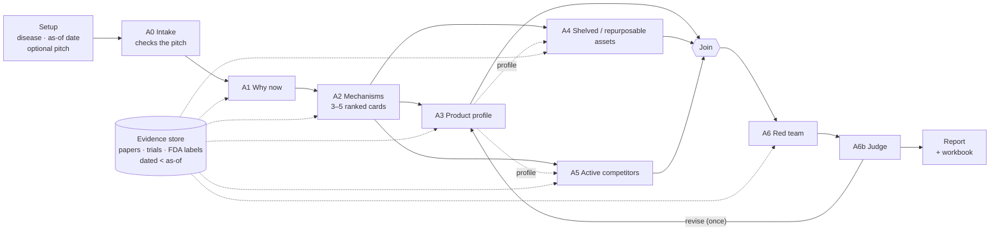

# Auctor

**Diligence-grade therapeutic hypotheses, in minutes, with every claim traced to a source.**

Auctor takes a disease and a date and returns a short list of therapeutic hypotheses that a biotech VC could act on (invest, license or build). For each hypothesis it explains why now is the time, which mechanism to target, what a winning product must do, who already owns something close, and what could kill the idea. A team of specialist AI agents does this work the way a diligence team would. Every statement cites a document from a date-bounded evidence store, and a red team attacks every idea before it reaches the report.

The first disease covered is **COPD** (`EFO_0000341`); the pipeline itself is disease-agnostic, and the evidence store is the part you rebuild per disease.

---

## Contents

- [What it answers](#what-it-answers)
- [How a run works](#how-a-run-works)
- [The agents](#the-agents)
- [Why you can trust the output](#why-you-can-trust-the-output)
- [Quick start](#quick-start)
- [The three ways to run it](#the-three-ways-to-run-it)
- [What a run produces](#what-a-run-produces)
- [Configuration](#configuration)
- [Repository layout](#repository-layout)
- [Documentation](#documentation)
- [Status and known limits](#status-and-known-limits)

---

## What it answers

| # | Question a VC asks | Agent |
|---|---|---|
| Q1 | **Why now?** What changed in the last 5 years that makes this disease workable? | A1 Disease Analysis |
| Q2 | **Which mechanism?** Which biology is worth targeting, ranked by human evidence? | A2 Mechanistic Analysis |
| Q3 | **What must the product do?** Measurable minimum and best-case specs (a target product profile). | A3 Optimal Solution |
| Q4 | **Who already owns something close?** Shelved assets to license or revive, and active competitors. | A4 Inactive assets · A5 Active landscape |
| Q5 | **What could kill it?** Failed trials, safety signals, one-lab findings, and the cheapest test to find out. | A6 Red Team · A6b Judge |

## How a run works



1. **Setup.** You pick a disease, an **as-of date** (today, or a past date for a backtest) and, optionally, a startup pitch (PDF, DOCX, TXT, MD or URL).
2. **A0 Intake** checks the pitch before anything else spends tokens: file type, size, extractable text, topic and prompt injection. If the pitch is rejected, the run stops there.
3. **A1** writes the "why now": at least 3 dated shifts (new endpoints, new patient segments, new trial tools), including at least one negative shift.
4. **A2** proposes 3–5 hypothesis cards. **Code, not the model**, sets each card's evidence tier and validation level from genetics, clinical phase and human literature, then ranks the cards.
5. **A3, A4 and A5 run side by side** for every card. A3 writes the product profile. A4 and A5 start their searches at the same time and pick up A3's profile when they reach their prompt step. A **join** step merges the three.
6. **A6 Red team** attacks each card from a deterministic risk checklist. **A6b Judge**, which sees only A3's and A6's outputs, decides survive, revise or kill. A card can go back for **one** revision round.
7. **Report.** The results go into a readable report, a live Excel workbook and full logs.

Cards are processed independently: one card's feedback, retries and verdict never leak into another card.

## The agents

| Agent | Job | Output |
|---|---|---|
| **A0 Intake** | Gate the startup pitch; compare what it cites with the store | accepted or rejected, cited items |
| **A1 Disease Analysis** | Why now: shifts over the 5 years before the as-of date, and patient segments with concrete criteria. Can add newly found, dated papers and trials to the store | shifts, segments |
| **A2 Mechanistic Analysis** | Ranked hypothesis cards built on existing modalities, with targets taken only from the association table | 3–5 cards with tier 1–4 and gold/silver/bronze validation |
| **A3 Optimal Solution** | Target product profile: the standard-of-care gap at launch, minimum and best-case specs, and 1–2 **measurable** must-haves | profile per card |
| **A4 Inactive assets** | Shelved or repurposable assets that fit the profile | candidates to license or revive |
| **A5 Active landscape** | Who is working on the mechanism now, crowding score and upcoming readouts | programs, crowding, catalysts |
| **A6 Red Team** | Risks (most severe first), each with a kill criterion and a cheapest test, plus a premortem. Four checkers feed it: safety, already exists, market and evidence | verdict and risks |
| **A6b Judge** | Rules on the red team's verdict without tools; its decision drives the routing | survives, revise or kill |
| **A7 Citations** | Checks that cited sources support the claims, optionally after every agent | stripped or downgraded claims |

The prompts are plain files in [`agents/prompts/`](agents/prompts). You can override them per workflow in [`workflow/prompts/`](workflow/prompts) or per node in Langflow.

## Why you can trust the output

- **Every claim has a source.** Agents may cite only documents in their evidence pack. A deterministic post-check strips any citation to a document outside the pack, and turns uncited statements into `reasoning` with a confidence cap.
- **No hindsight.** Every read is bound to the as-of date, and nothing dated on or after it is returned. You can run Auctor "as of" a past date and check its calls against what actually happened (a backtest).
- **Calibrated confidence.** Confidence is capped by evidence tier (tier 1 ≤ 0.9 … tier 4 ≤ 0.4). Code, not the model, computes the tiers, the ranking and the risk checklist.
- **It argues with itself.** The red team and the judge must deal with failed precedents, retractions, unreplicated findings and safety signals. A card is killed, revised once, or survives with its top risk spelled out.
- **Fully traceable.** Every claim records the agent that made it and its source ids. Every prompt, raw answer and tool call is logged.

## Quick start

**You need:** macOS or Linux, conda, Docker Desktop, [Git LFS](https://git-lfs.com), and a [Nebius Token Factory](https://tokenfactory.nebius.com) key for live runs. Stub runs need no key.

```bash
# 1. Clone (Git LFS brings the embeddings and the database snapshot)
git lfs install
git clone https://github.com/DevSoVague/auctor.git && cd auctor
git lfs pull

# 2. Python environments
conda create -n hack python=3.12 -y && conda activate hack
pip install -r requirements-person3.txt                     # engine, LangGraph, evidence store

conda create -n langflow python=3.11 -y && conda activate langflow
pip install -r requirements-langflow.txt                    # Langflow 1.8.4 + the above

# 3. Keys (never commit .env; it is gitignored)
cp .env.example .env        # then fill in NEBIUS_API_KEY (and the optional keys)

# 4. Evidence store: Postgres + pgvector in Docker on :5433, restored from the snapshot
cd evidence-store && make db-up
gunzip -c data/dump/frontier.sql.gz | docker exec -i evidence-store-db psql -U frontier -d frontier
cd ..

# 5. Start everything: the database (if down), Langflow on :7870 and the Auctor workspace
python3 frontier-ui/server.py --port 7881
```

Open **http://127.0.0.1:7881** for the workspace and **http://127.0.0.1:7870** for Langflow. Ctrl+C stops what the launcher started. The database keeps running and keeps its data.

> To rebuild the store from the caches without calling any model: `cd evidence-store && make cache-import && make all`. See the [evidence-store README](evidence-store/README.md).

## The three ways to run it

All three use the same agent code.

| Front end | Best for | How |
|---|---|---|
| **Langflow canvas** | Demos, the fastest runs (A3/A4/A5 in parallel), editing prompts and models per step | Open the **P3 steps** flow, set **P3 · Setup**, open **Playground**, send `run` |
| **Auctor workspace** (`frontier-ui`) | Reading results: overview, hypothesis comparison, evidence library, scientific report (print to PDF), run history | `python3 frontier-ui/server.py --port 7881` |
| **CLI / LangGraph Studio** | Scripted runs, tests, guided human review | `cd workflow && conda run -n hack python -m p3graph run …` |

**CLI examples**

```bash
cd workflow
conda run -n hack python -m p3graph run                                   # stub: fixtures, 0 tokens
conda run -n hack python -m p3graph run --llm live --search evstore \
    --tools --max-cards 1                                                 # live, one card, tools + judge
conda run -n hack python -m pytest -q                                     # tests
```

**Watching a run:** the **Node Monitor** at http://127.0.0.1:7872 (`python -m p3graph.live` from `workflow`) shows every step of every card live: prompts, streamed output, timers and errors.

**Main Setup fields (Langflow):**

| Field | Default | Meaning |
|---|---|---|
| LLM mode | `stub` | `stub` = fixtures, 0 tokens; `live` = real models |
| As of | `today` | Or `YYYY-MM-DD` for a backtest |
| Max cards | 1 | How many hypotheses to take through A3–A6 (0 = all) |
| A3 / A4 / A5 cards in parallel | 3 / 3 / 3 | How many cards each agent works on at once |
| Cards in parallel | 6 | The same, for the other steps |
| Agent tools | on | Evidence-store reads (and web search for A1/A4/A5) |
| A7 citation check | off | `every node`, `end only` or `off`. The post-check runs regardless |
| A6b judge decides | on | Whether the judge's ruling drives routing |

## What a run produces

Every run writes to `workflow/runs/<run_id>/`:

| File | Contents |
|---|---|
| `report.md` | The answer: an **at a glance** table, then one section per hypothesis (verdict, what the product must do, biggest risk with kill criterion and cheapest test, competition, assets to license), why now, run details and a decision log |
| `analysis.xlsx` | Live workbook: WhyNow, Segments, Hypotheses, TPP, RedTeam, Claims, ToolCalls, NewEvidence, Judge, Events, Meta (tokens and USD per agent) |
| `chat.md` | One plain-language message per step |
| `log.md` / `log.jsonl` | Full prompts, raw answers, reasoning and evidence packs, untruncated |
| `live.jsonl` | The event stream the Node Monitor replays |
| `result.json` | Final state (cards, profiles, assets, verdicts, judgments, decisions, usage) for downstream tools |
| `failures.log` | Present only if a card failed. The other cards continue |

## Configuration

Copy [`.env.example`](.env.example) to `.env` at the repo root. Only `NEBIUS_API_KEY` is required for live runs.

| Variable | Purpose |
|---|---|
| `NEBIUS_API_KEY`, `NEBIUS_BASE_URL` | Default account for every agent |
| `NEBIUS_API_KEY_A4_A5` | Optional second account for A4 and A5 (their model calls, tools and embeddings), so they don't share rate limits with A3 |
| `EMBED_API_KEY` | Optional account for evidence-store query embeddings |
| `TAVILY_API_KEY` | Optional web search for A1/A4/A5 |
| `LOCAL_LLM_BASE_URL` | Use a local OpenAI-compatible server instead of Nebius |
| `NEBIUS_MODEL_<AGENT>` | Per-agent model overrides |

**Ports:** workspace 7881 (default 7880), Langflow 7870, Node Monitor 7872, LangGraph Studio 2034, Postgres 5433.

## Repository layout

```
auctor/
├── agents/                 The agents themselves
│   ├── analysis/           A0–A3, A6, A6b, A7; LLM layer, tool loop, retrieval, evidence-store tools
│   ├── competitor/         A4 inactive assets and A5 active landscape
│   └── prompts/            One system prompt per agent (markdown)
├── workflow/      The workflow
│   ├── p3graph/            LangGraph state machine, CLI, report, Node Monitor (live.py / live.html)
│   ├── langflow/           Langflow components and flows (A3/A4/A5 fork + join), launcher
│   ├── prompts/            Workflow-level prompt overrides
├── evidence-store/         COPD evidence store: Postgres + pgvector in Docker
│   ├── evstore/            Build, embed, extract and the as-of-bound StoreClient
│   ├── sql/                Base schema + RAG and lookup tables
│   └── data/               Embedding cache and database snapshot (Git LFS)
├── docs/                 FSD, TSD, HOW_TO_RUN, schema, editing guide, graph diagram
├── frontier-ui/            Auctor workspace (no build step) and the one-command launcher
├── exports/                Excel workbook writer
├── scripts/                Plain async runner, model comparison, tool probe, fixtures
├── tests/                  Engine and A4/A5 tests with fixtures
├── requirements-person3.txt / requirements-langflow.txt
└── .env.example            Every variable the code reads, with no values
```

## Documentation

| Doc | Read it for |
|---|---|
| [HOW_TO_RUN.md](docs/HOW_TO_RUN.md) | Every way to run it, ports, the monitor and troubleshooting |
| [FSD.md](docs/FSD.md) | What the system must do: requirements per agent, workflow rules, acceptance criteria |
| [TSD.md](docs/TSD.md) | How it works inside: step chains, prompts, grading, parallel fork/join, account routing, report |
| [DATABASE_SCHEMA.md](docs/DATABASE_SCHEMA.md) | The evidence-store tables |
| [EDITING.md](docs/EDITING.md) | Changing prompts, models and nodes |
| [evidence-store/README.md](evidence-store/README.md) | Building, restoring and querying the store |
| [frontier-ui/README.md](frontier-ui/README.md) | The workspace UI |
| [copd_sample_memo.html](docs/copd_sample_memo.html) | Sample investor-facing page: pursuits, directory, method (demo data from a test run) |
| [COPD_run_results_analysis.html](docs/COPD_run_results_analysis.html) | Analysis of a live COPD run: timeline, tokens and time, hypotheses, loopbacks and failures, decision log |
| [HANDOFF.md](HANDOFF.md) | Tool access rules, data window and open tasks |

## Status and known limits

- **Evidence window:** 2023-01-01 to 2025-12-31, plus what A1 adds during runs. The years 2020–22 are left out because COVID confounds the COPD evidence.
- **Store coverage:** 50 COPD drug-trial papers, 41 trials, 6 FDA labels, 6 shelved programs and market data. There is no Open Targets or EDGAR data yet, so A4/A5 can come back thin.
- **Backtests before 2025** see no on-market drug data, because the FDA labels and market rows are dated 2025.
- **Models know the future.** A model trained past the cutoff may still "know" later events. The prompts forbid using them and uncited claims are capped, but nothing can block it outright.
- **Parallelism:** A3/A4/A5 run side by side in the Langflow flow. The CLI graph still runs them one after the other.
- **Stub runs** use fixtures and are for testing only. Their reports say "Stub run" at the top.

