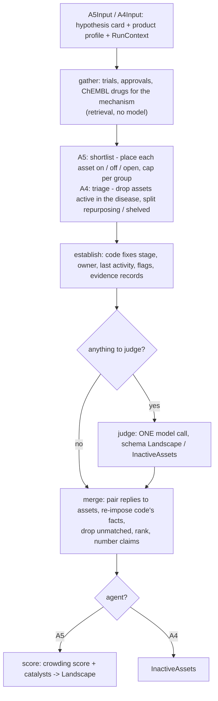

# Agents 4 and 5 (Adam): workflow

Source: `adam-repo/` (clone of `vidhi-ds-24/Ctrl-Alt-Cure`, branch `team-role-4-adam`, HEAD `62213b0`), under `src/frontier/agents/competitor/`. Prompts: `src/frontier/agents/prompts/a4_inactive.md`, `a5_active.md`.

Not yet run on this machine: installing the repo's environment (`uv sync`) and running its tests was blocked by the auto-mode classifier. Adam's run log reports 188 passed, 1 skipped (a Postgres test) with `make test`.

## One run of A5 or A4

Step lists (`STEPS` in each file): A5 = gather, shortlist, establish, judge, merge, score. A4 = gather, triage, establish, judge, merge. Fixed edges, no model chooses the next step.

## Numbered steps

1. **gather.** Runs in parallel: trials for the disease, approvals for the disease, and the ChEMBL drug index for the hypothesis mechanism. A5 keeps assets in the disease. A4 also searches ctgov and fda by each mechanism-matching drug's names (100 hits each), so it sees programs outside the disease.
2. **shortlist (A5) / triage (A4).**
   - A5: `Mechanism.place` marks each asset `on` (programs), `off` (orthogonal) or `open` (code can't tell). Caps: programs 30, orthogonal 20, open 20, most advanced first.
   - A4: `classify` drops anything active in the disease (that is A5's) and puts the rest on `repurposing` (approved or in development elsewhere) or `shelved` (never approved, stopped or stale).
3. **establish.** Code builds each asset's facts and the dated records the model may cite. A4 caps at 20 per list, code-placed first, then by stage and recency. Evidence per asset is at most 4 records, text trimmed to 800 chars.
4. **judge.** One model call, skipped if the list is empty. It judges relevance, novel edge / limitation, profile fit and (for `open` / model-placed assets) whether they act on the mechanism.
5. **merge.** Replies are matched back to assets. Code's facts overwrite the model's (stage, owner, flags, funding). The model can drop an asset but not invent, restage or re-cite one. Dropped and unmatched names are recorded under `matching`. Rank: A5 by fit (`yes`/`partly`/`no`), then stage; A4 by `profile_fit` times placement weight, then stage, then recency. A4 returns at most 10 per list.
6. **score (A5 only).** Crowding score from stage weights of programs on the mechanism, plus catalysts within 365 days of `as_of`.

## Exact prompts

Verbatim in `adam-repo/src/frontier/agents/prompts/a4_inactive.md` and `a5_active.md`. Both receive JSON of `disease`, `as_of`, `hypothesis`, `product_profile` and the asset list (`programs` for A5, `assets` for A4), and say "Reply with the JSON object only." Key rules in both: drop don't invent, cite only shown ids, stay before `as_of`, be short.

## Gotchas

- Both steps modules use LangGraph directly (`steps.build_graph`, one node per step); `run_steps` is the plain-asyncio twin running identical code. `audit_graph` returns a JSON-safe per-step trail.
- A5 returns `crowding_score: 0` and `catalysts: []` from the model on purpose; code computes both.
- `placed_by: "model"` assets rank at reduced weight (`PLACEMENT_WEIGHTS`, `CrowdingParams`) and carry an extra reasoning claim.
- `STALE_MONTHS = 18` is a PROPOSAL (the PRD leaves it open). A trial seen only as registered never makes a program stale (backtest safety).
- Mechanism matching keeps subtype numbers (PDE3 is not PDE4; beta-1 is not beta-2). Drugs with no ChEMBL mechanism use `mechanism_text` of "" so they don't pool as "unknown".
- Patents are not wired in yet (A4 docstring: plugs into `gather` when retrieval serves them).

## Differences that matter for integrating with A1/A2/A3/A6

| Area | Adam / team repo | Ours (`frontier-engine`) |
|---|---|---|
| Layout | `src/frontier/...`, uv, ruff | flat `agents/`, `hack` conda env |
| LLM | `ctx.llm(agent=, messages=, schema=)` via `core/router.py`, profiles.yaml, cache, cost log | Nebius shim in `frontier-engine` |
| Retrieval | `ctx.retrieval` (stub fixtures, then person 1's ingest) | our own retrieve step per agent |
| Schemas | `frontier.agents.schemas` (person 2 owns) | our local schema additions, pending to person 2 |
| Step style | `(name, async step)` tuples + `build_graph` | step functions + `chain.py`, LangGraph `p3graph/steps.py` |

Both sides already split agents into named steps, so integration should be mapping our A1/A2/A3/A6 onto Adam's `steps.py` tuple shape and the `RunContext`, not rewriting.

## What persists / can be observed

| Thing | Where |
|---|---|
| Per-step audit trail | `audit_graph(...)` return value |
| Dropped / unmatched assets | `state["matching"]`, warning log |
| Assets cut by caps | `state["cut"]`, warning log |
| Fixtures | `adam-repo/tests/fixtures/competitor/` |
| Adam's own history | `adam-repo/runlog/2026-11-07-adam.md` |
